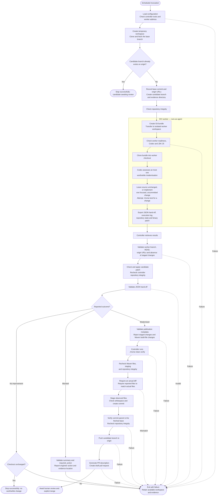

# Scheduled Java modernisation runner

[`run-scheduled-java-modernisation.sh`](run-scheduled-java-modernisation.sh)
runs one Java 25 modernisation assessment against a fresh clone of a GitHub
repository. Codex may implement **at most one focused improvement**. When the
returned change passes the controller's checks and independent Maven build, the
runner commits it, pushes a candidate branch, and opens a
**draft pull request**. Human review and an explicit merge decision follow
separately.

The script performs one invocation; it does not install a schedule or loop. An
external scheduler must invoke it and supply the required environment and
credentials. Run invocations sequentially.

## Controller and worker responsibilities

| Location                                                         | Responsibility                                                                                                                                   |
| ---------------------------------------------------------------- | ------------------------------------------------------------------------------------------------------------------------------------------------ |
| Controller: the machine invoking this script                     | Clone GitHub, prepare the branch, transfer inputs, validate returned evidence, run `./mvnw clean verify`, commit, push, and create the draft PR. |
| OCI worker: SSH connects as `opc`, then uses `sudo -n -iu agent` | Clone the transferred Git bundle, run Codex as `agent`, and export a patch and evidence.                                                         |
| Human reviewer                                                   | Assess the proposed change and decide whether to merge or reject it.                                                                             |

The bundle carries repository files and Git history. The runner does not send
controller Git configuration, credentials, hooks, or a forwarded SSH agent.
Worker Codex authentication must already exist under `agent`. The worker's
`origin` points to the uploaded bundle, rather than GitHub.

## Prerequisites and configuration

The controller needs Bash, OpenSSH, Git, GitHub CLI (`gh`), `jq`, JDK 25, and
the usual command-line utilities used by the script. Configure Git author
identity, Git clone/push authentication, and GitHub CLI authentication with
permission to create a branch and PR in the selected repository. Maven runs
through the cloned project's `./mvnw`; dependency downloads need suitable
network access. The script checks that controller `java` and `javac` exist, but
does not check their versions.

The worker must already be provisioned with the `opc` and `agent` accounts,
non-interactive sudo from `opc` to `agent`, `/home/agent/work`, Git, `jq`,
Codex, and JDK 25. Its login environment must set `JAVA_HOME` and `PATH`. The
script requires `/var/lib/java-worker/ready` and rejects a worker with
`/var/lib/java-worker/failed`. It also checks that the worker compiler is Java
25. Authenticate Codex as `agent` before invoking the runner.

All configuration values below are environment variables:

| Variable                                   | Default in the script                                          | Purpose                                                                         |
| ------------------------------------------ | -------------------------------------------------------------- | ------------------------------------------------------------------------------- |
| `CODEX_MODERNISATION_SOURCE_REPOSITORY`    | `https://github.com/albertattard/demo-supermarket-starter.git` | Repository to clone and publish to. Set this to your own fork when appropriate. |
| `CODEX_MODERNISATION_BASE_BRANCH`          | `main`                                                         | Branch to assess and target with the draft PR.                                  |
| `CODEX_MODERNISATION_BRANCH_NAME`          | `codex/modernisation`                                          | Candidate branch and remote marker for outstanding work.                        |
| `CODEX_MODERNISATION_WORKER_HOST`          | None (required)                                               | Worker IPv4 address or hostname; set it explicitly for your worker.             |
| `CODEX_MODERNISATION_SSH_PRIVATE_KEY_PATH` | None (optional)                                               | Controller SSH private key used to connect as `opc`; otherwise use SSH configuration or ssh-agent. |
| `TMPDIR`                                   | `/tmp`                                                         | Parent directory for the controller's temporary workspace.                      |

The script uses `${VARIABLE:-default}` expansion: both an unset variable and an
empty value select the default. The worker host has no default and must be set
explicitly. If the SSH key variable is unset or empty, the script uses ordinary
SSH key selection through local SSH configuration or ssh-agent. If a key path
is supplied, the script passes it with `IdentitiesOnly=yes`.

For example, from your starter repository checkout:

```shell
CODEX_MODERNISATION_SOURCE_REPOSITORY="$(git remote get-url origin)" \
CODEX_MODERNISATION_WORKER_HOST='<worker-ip-or-hostname>' \
CODEX_MODERNISATION_SSH_PRIVATE_KEY_PATH="$HOME/.ssh/<worker-key>" \
  ./tools/run-scheduled-java-modernisation.sh \
  > /tmp/run-scheduled-java-modernisation.log 2>&1
```

This command can push a branch and create a draft PR. The script operates on a
new temporary clone, so local uncommitted changes in the invoking checkout are
not assessment inputs. A scheduler needs the same tools, environment, and
non-interactive authentication as a manual invocation.

## How each part works

### 1. Set shell behaviour and SSH options

`set -euo pipefail` stops execution on unhandled command failures, unset
variables, and failed pipelines. `umask 077` restricts access to newly created
files and directories. `PAGER`, `GIT_PAGER`, and `GH_PAGER` are set to `cat` so
unattended commands do not wait for someone to dismiss a pager.

SSH uses batch mode, a connection timeout, one connection attempt, and keepalive
checks. It accepts previously unseen host keys and rejects changed known keys.
Agent forwarding and other configured forwardings are disabled. These SSH
settings do not impose a maximum duration on the whole assessment.

### 2. Define reusable checks

- `fail` writes an error to stderr and exits with status 1.
- `stop` reports an expected no-op outcome and exits with status 0.
- `assert_repository_integrity` checks the controller's current branch, `HEAD`,
  candidate branch commit, and every origin fetch/push URL against expected
  values. It runs repeatedly before consequential Git decisions.
- `assert_maven_definition_unchanged` rejects changes to `pom.xml` files,
  `.mvn`, `mvnw`, and `mvnw.cmd`, including new ignored build inputs present in
  the controller checkout. This prevents the controller from knowingly running
  an agent-modified Maven definition or wrapper.
- `assert_modernised_handoff` checks the publication metadata in the worker's
  JSON response before verification and publication. These are basic field
  checks, rather than a complete JSON schema or a correctness review.

### 3. Prepare a fresh controller checkout

After checking the worker address format and required controller executables,
the runner creates `demo-supermarket-modernisation.XXXXXX` beneath `TMPDIR`. It
keeps the checkout in `repository/` and its own evidence in the sibling
`evidence/` directory, preventing runner evidence from entering the candidate
diff.

It clones the configured base branch, explicitly refreshes its remote-tracking
ref, and asks whether the candidate branch already exists on `origin`. If so, it
stops successfully before starting Codex. Branch existence alone blocks another
assessment, regardless of whether a PR is open, closed, or merged.

Otherwise, it records the fetched base commit and origin URLs, creates the local
candidate branch from that base, and verifies the initial repository state.

### 4. Transfer the repository and prepare the worker

The controller requests a unique `/home/agent/work/modernisation.XXXXXX`
directory as `agent` and validates the returned path before using it in remote
commands. It prints the controller evidence path and worker workspace location.

It creates `input.bundle` for the prepared candidate branch, uploads it over
SSH, and generates a per-run `worker.sh` on the controller. That script executes
on the worker as `agent`, checks worker readiness, Codex availability, and JDK
25, then clones the bundle into a fresh `repository/` directory.

Before starting Codex, the script runs
`./mvnw --batch-mode --no-transfer-progress clean package` as `agent`, outside
the Codex sandbox. This downloads Maven and the dependencies and plugins needed
through the package phase into the same account's cache, and runs the baseline
unit tests. Preparation output is captured in `evidence/worker.log`. A build
failure or a non-clean Git checkout stops the run before Codex starts.
Dependencies used only by later lifecycle phases are not necessarily cached.

### 5. Run the bounded Codex task

The worker invokes `codex exec` with `--ephemeral`, the `workspace-write`
sandbox, model `gpt-6.1-sol`, and medium reasoning effort. Its final response
goes to `handoff.json`; execution output goes to `agent.log` outside the
checkout.

The runner reads [`java-modernisation-prompt.md`](java-modernisation-prompt.md)
beside the script, saves the exact input as `evidence/prompt.md`, and uploads
that snapshot to the worker for Codex to read through stdin. The workshop
command uses the same prompt file.

The shared prompt asks Codex to inspect code and tests, select one worthwhile
Java 25 improvement, implement it, attempt `./mvnw test`, and review the final
diff. It requires preservation of observable behaviour, public routes,
persistence behaviour, and test intent. If no change offers a material benefit,
Codex should leave source files untouched.

The prompt prohibits changing the Java baseline, Maven definitions or wrappers,
Git branches, staging, commits, pushes, and PR creation. It also prohibits Maven
`verify`, approval requests, and attempts to bypass execution/network policy.
Worker test results must be reported honestly as passed, blocked, or not-run.
If implementation cannot be completed safely, Codex returns a `blocked` outcome
with a concrete `required_action` and a summary of any partial changes. Blocked
worker tests alone do not require a blocked outcome because the controller
independently verifies implemented changes.
These instructions guide the model; they are not themselves a security boundary.

### 6. Export and retrieve the results

After Codex exits successfully, the worker records its branch, `HEAD`, origin
URLs, and whether Codex staged anything in `repository-state.json`. It records
staging **before** its own patch preparation touches the index.

It then marks non-ignored new files with `git add --intent-to-add` and writes
`candidate.patch` using a binary-capable diff against `HEAD`. The patch includes
tracked changes and non-ignored new files; ignored new files are not exported.
The controller downloads the patch, repository state, hand-off, and agent log.
An SSH or worker execution failure stops the run.

### 7. Validate state, apply the patch, and interpret the hand-off

The controller requires the worker to remain on the prepared branch and base
commit, with origin still pointing at the input bundle and no agent-staged
changes. It checks that the patch applies before applying it, then rechecks its
own repository integrity and validates the hand-off's outcome.

| Outcome                                    | Required evidence and action                                                                                                                                   |
| ------------------------------------------ | -------------------------------------------------------------------------------------------------------------------------------------------------------------- |
| `no-improvement`                           | Codex supplies a summary. The controller requires a clean checkout and exits successfully without publication.                                                 |
| `modernised`                               | Codex supplies `title`, `commit_message`, `summary`, `files_changed`, `validation`, and `review_focus`. The controller proceeds through its publication gates. |
| `blocked` | Codex supplies a nonblank `summary` and `required_action`. The controller reports both, retains evidence and any partial changes for inspection, and exits with status 1 without verification or publication. |
| Missing, malformed, or unsupported outcome | The run fails.                                                                                                                                                 |

The metadata validator does not fully enforce the prompt's response contract.
For example, its current commit-message predicate accepts an empty string, and
it only requires a nonempty `validation` array without validating each entry.
The independently observed diff and controller build remain separate checks.

### 8. Independently verify the candidate

For a `modernised` outcome, the controller rejects staged changes and modified
Maven inputs before running `./mvnw clean verify`. Worker test reports never
replace this build. A blocked worker test can therefore still lead to a draft PR
if the independent controller verification and all remaining checks pass.

After the build, it checks Maven inputs, staging, and repository integrity
again. It independently collects modified and non-ignored untracked paths,
requires a nonempty change set, and compares that list with `files_changed`. The
lists must match exactly before any files are staged for publication.

### 9. Commit, push, and open a draft PR

The runner stages only the independently observed files, checks the staged diff
for whitespace errors, and commits using the hand-off's commit subject. It
requires the new commit's parent to be the fetched base commit and rechecks the
branch, commit, and origin URLs immediately before pushing.

It pushes the candidate branch, builds `pull-request.md` from the hand-off and
observed file list, adds the successful controller verification result, and uses
`gh pr create --draft` against the configured base branch. It never merges the
PR.

## Flowchart



## Evidence, failures, and subsequent runs

The controller retains the following layout; later-stage files exist only if the
run reaches the relevant stage:

```text
demo-supermarket-modernisation.XXXXXX/
├── repository/                 # Controller clone, applied changes, and any commit
├── input.bundle                # Prepared branch and its history
├── worker.sh                   # Generated remote execution script
└── evidence/
    ├── worker.log              # Remote execution output and errors
    ├── prompt.md               # Exact prompt supplied to Codex
    ├── agent.log               # Codex execution output copied from the worker
    ├── handoff.json            # Codex's final JSON response
    ├── repository-state.json   # Worker Git-state observations
    ├── candidate.patch         # Returned binary-capable patch
    ├── actual-files.txt        # Independently observed changed paths
    ├── reported-files.txt      # Paths reported by Codex
    └── pull-request.md         # Generated draft-PR description
```

The worker retains its bundle, prompt snapshot, checkout, hand-off, agent log, state
observations, and patch under the printed worker workspace. `--ephemeral` does
not remove these runner-owned files. Neither machine's run directories are
automatically cleaned up; remove old directories manually after retaining needed
evidence.

A failure exits nonzero and retains available work for inspection. Publication
is not transactional: if the push succeeds but PR creation fails, the remote
candidate branch remains and blocks later assessments. Inspect that branch and
the evidence, then create the draft PR manually or deliberately remove the
candidate branch after deciding to discard it. After reviewing a successful PR,
delete its remote candidate branch when it is appropriate to allow another run.

There is no local lock or cross-machine reservation before assessment. Separate
workspaces prevent checkout reuse, but overlapping invocations can duplicate
model/build work and race at publication. The push uses ordinary Git conflict
handling; branch existence is back pressure for later invocations, not a lock.
The runner also does not refresh or compare the base branch again before
publication, so a candidate can target a base that has advanced during the run.

The integrity checks and Maven-input checks detect specific unexpected changes;
they do not make returned code safe to execute. The controller still executes
repository-controlled build and test code with its own environment. Review
untrusted repository inputs accordingly, and retain human review before merge.
